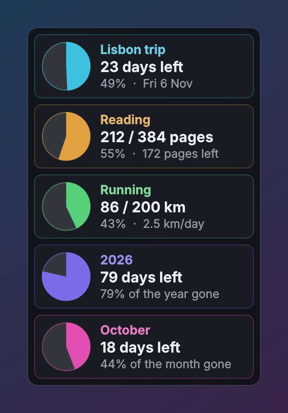
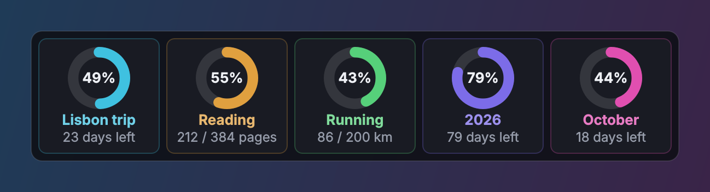

# Progress Pies

   

A small desktop widget that shows progress as pie charts — days left until a
trip, how far through a book you are, how much of the year has gone. It docks to
the right edge of the screen by default and remembers everything between runs.

<p align="center">
  
</p>
<p align="center">
  
  <br><sub>The same trackers with <i>Pies only</i>, <i>Donut</i> and <i>Horizontal</i> from the menu</sub>
</p>

## Requirements

* Windows 10 or 11
* Python 3.10 or newer on `PATH` ([python.org](https://www.python.org/downloads/))
* [PySide6](https://pypi.org/project/PySide6/) — installed automatically by `run.bat`

## Running it

```
git clone https://github.com/viruztt/ProgressPies.git
cd ProgressPies
run.bat
```

Or download the ZIP from GitHub, extract it, and double-click **`run.bat`**.
The first run creates a `.venv` beside the script, installs PySide6, then
launches with `pythonw` (no console window). A fresh install starts with three
example trackers so the widget isn't empty — edit or delete them.

Then run **`install_startup.bat`** once so it starts with Windows.
**`remove_startup.bat`** undoes it. If you move or rename the folder, run
`install_startup.bat` again.

* **`list.bat`** prints every tracker and its progress to a console.
* **`selftest.bat`** checks the date maths and the data file.

## Tracker types

| Type | What the pie shows | Example |
|---|---|---|
| **Countdown** | Time elapsed between *count from* and the *target date* (optionally a time of day) | "Lisbon trip — 24 days left" |
| **Counter** | *current* of *total*, in any unit | "Dune — 120 / 384 pages" |
| **Day / week / month / year** | How far through the current period you are — fills on its own | "2026 — 80 days left" |

**Countdown** — *count from* is when the wait started (the day you booked, say),
so the pie fills as the date approaches. It reads *Tomorrow*, then *Today!*, then
*n days ago* with a tick.

**Counter** — set *Started on* and the tooltip shows your pace and a finish
estimate ("Your pace: 11 pages/day → finish around Wed 18 Nov"). Set a
*deadline* and the card shows how much per day you need instead. Each day's
value is logged in the data file.

Any tracker can be flipped to show **what's left** (the pie empties) instead of
progress made.

## Using it

* **Right-click** a pie for its own actions (+/−, *Set value…*, *Edit…*, hide,
  delete) and for the widget settings.
* **Double-click** a pie to edit it. **Edit trackers…** opens the full list:
  add, duplicate, delete, drag to reorder, pick colours, with a live preview.
* **Scroll** over a counter to change it by its step (one notch = one step).
  Turn that off with *Scroll wheel changes counters*.
* **Drag** the widget anywhere. Let go within 40 px of the left or right edge and
  it docks there, staying flush with the edge as it grows or shrinks; let go
  elsewhere and it floats where you left it. *Dock* in the menu does the same,
  and *Vertical position* puts a docked widget at the top, middle or bottom.
* **Layout**: *Pie + text* cards, or *Pies only* (a compact strip, name and
  main figure under each pie). **Chart**: filled *Pie* or *Donut* (with the
  percentage in the middle). **Orientation**: a vertical column or a horizontal
  row; either wraps when it runs out of screen.
* **Hide completed** drops finished countdowns and counters from the widget.
* **Window layer**: *Always on top*, *Normal*, or *Always at the bottom* (sits
  on the wallpaper). The widget has no taskbar button — if you lose it, use
  **Bring to front** on the tray icon. *Click-through* can be switched off from
  the tray too.

## From the command line

```
python main.py --list
python main.py --add dune 25        # read 25 more pages
python main.py --set dune 210       # jump to page 210
```

The name is case-insensitive and a unique prefix is enough. A running widget
picks the change up within a couple of seconds — so this also works from a
script, a scheduled task, or a Stream Deck button.

## Where the data lives

`data/trackers.json` next to the app — plain, indented JSON you can edit by
hand (the widget reloads when the file changes):

```json
{"version": 1, "trackers": [
  {"id": "a1b2c3d4", "name": "Lisbon trip", "type": "countdown", "color": "#3FC1E0",
   "reverse": false, "visible": true, "start": "2026-09-23", "target": "2026-11-06"},
  {"id": "e5f6a7b8", "name": "Dune", "type": "counter", "color": "#E0A03F",
   "reverse": false, "visible": true, "current": 120, "total": 384, "unit": "pages",
   "step": 1, "started": "2026-10-03", "deadline": "", "log": [["2026-10-13", 120]]},
  {"id": "c9d0e1f2", "name": "", "type": "period", "color": "#7C6CE8",
   "reverse": false, "visible": true, "period": "year"}
]}
```

`target` takes `YYYY-MM-DD` or `YYYY-MM-DDTHH:MM`. `period` is `day`, `week`,
`month` or `year`; a blank name shows the current year, month or week number.

Every save goes through a temp file and an atomic rename with one rolling
`.bak`, and the backup is loaded if the main file is ever unreadable. Set
`data_path` in `config.json` to keep the trackers elsewhere (OneDrive, say).

## Configuration

`config.json` is written next to `main.py` whenever you change something from
the menu.

| Key | Meaning |
|---|---|
| `dock` | `right` (default), `left`, or `none` for floating |
| `valign` | `top`, `center`, `bottom` — where a docked widget sits until dragged |
| `margin` | Gap to the screen edge when docked, in pixels |
| `layout` | `cards` (pie + text) or `pies` (pies only) |
| `chart` | `pie` or `donut` |
| `orientation` | `vertical` or `horizontal` |
| `hide_completed` | Drop finished trackers from the widget |
| `wheel_adjust` | Scrolling over a counter changes it |
| `refresh` | Seconds between re-evaluations (default 30) |
| `window_layer` | `top`, `normal`, or `bottom` |
| `opacity`, `font_size`, `click_through` | Appearance |
| `data_path` | Where the trackers live (blank = `data/trackers.json`) |

## Only one at a time

A second launch just re-shows the widget that is already running, since two
copies would overwrite each other's edits. Point a second copy at a different
`data_path` if you really want two.

## Layout

```
main.py               entry point (--list, --add, --set, --selftest)
run.bat               first-run installer + launcher
install_startup.bat   add/remove the Windows startup shortcut
remove_startup.bat
list.bat              print all trackers
selftest.bat          date maths + data file check
tools/
  make_screenshot.py  renders docs/*.png from example trackers
pies/
  model.py            tracker types and the maths (no Qt)
  store.py            trackers.json, atomic save, reload on change
  config.py           JSON settings
  card.py             one pie card + the pie painter
  widget.py           the docked window, menus, tray
  editor.py           the add/edit dialog
  theme.py            dark Fusion theme for menus and dialogs
```

Your trackers (`data/`) and settings (`config.json`) are git-ignored, so they
never end up in the repository.

## License

[MIT](LICENSE)
